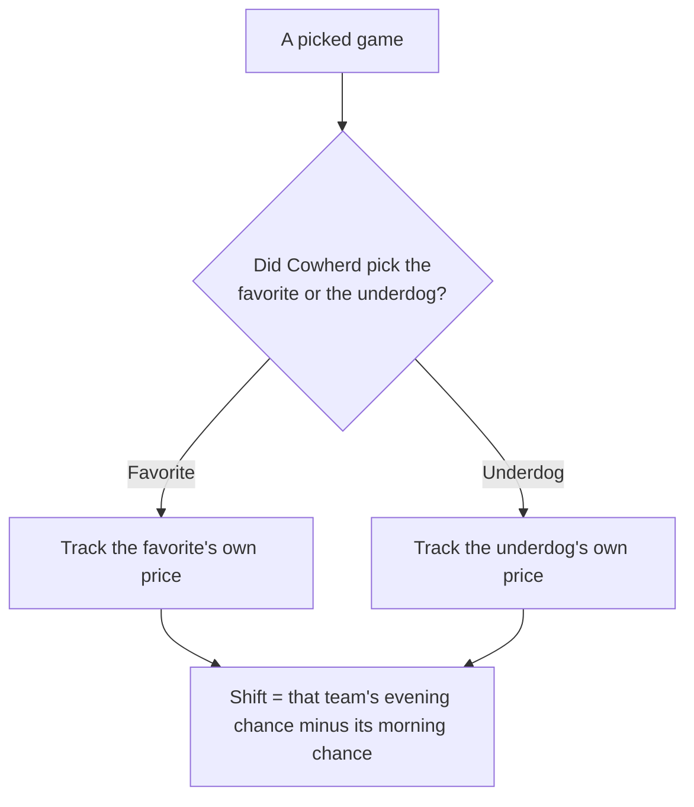
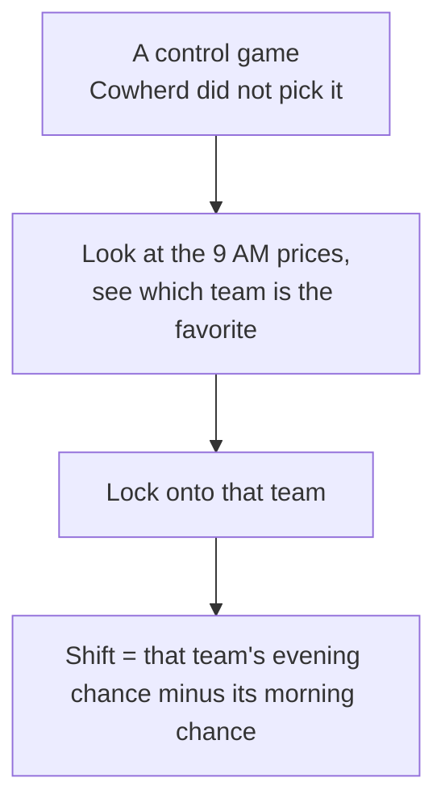

---
hide:
  - toc
---

# Win % Calculation

This page shows the full calculation behind the study, so every number can be reproduced step by step. It covers converting a betting price into a plain percentage chance of winning, fixing which team's chance each game tracks, defining the one per-game number the test runs on, and then working the whole comparison step by step to the final results table. The design, hypotheses, test choice, and interpretation are in the [Full Report](./report.md).

## What a Betting Price Is

A sportsbook lists each team with a price called a **moneyline**, written as a number such as `-148` or `+130`. The price encodes how likely the book considers the team to win. The study converts each price into a percentage — the team's **implied chance of winning** — and measures how that percentage changes over one day. There are two cases:

- **A favorite** carries a *negative* price, such as `-148`. The larger the number, the stronger the favorite.
- **An underdog** carries a *positive* price, such as `+130`. The larger the number, the longer the odds.

## Turning a Price Into a Chance of Winning

The two cases are a single formula. A moneyline is always quoted against a $100 bet, and the win chance is:

```
win chance = amount risked / (amount risked + amount won)
```

The favorite and underdog cases look different only because the sign indicates *which* of the two amounts is the $100:

- A **favorite** has a negative price, like `-148`, meaning "risk $148 to win $100." The amount risked is 148, so it goes on top.
- An **underdog** has a positive price, like `+130`, meaning "risk $100 to win $130." The amount risked is 100, so 100 goes on top.

In both cases, use the **absolute value** of the price — its size without the sign (the absolute value of `-148` is 148, and of `+130` is 130). The two formulas below are the same fraction; the only thing that moves is whether that absolute value or a flat `100` sits on top.

**Favorite (negative price):** the numerator is the price's absolute value.

```
win chance = |price| / (|price| + 100)
```

Worked example with `-148` (absolute value 148):

```
win chance = 148 / (148 + 100)
           = 148 / 248
           = 0.597   ->  59.7%
```

**Underdog (positive price):** the numerator is 100 instead.

```
win chance = 100 / (|price| + 100)
```

Worked example with `+130` (absolute value 130):

```
win chance = 100 / (130 + 100)
           = 100 / 230
           = 0.435   ->  43.5%
```

So the **only** difference between the two is the numerator: the favorite's own size for a favorite, a flat `100` for an underdog — because that is which side put up the $100. The denominator (`|price| + 100`) is identical. To turn the result into a percentage, multiply by 100 (0.597 → 59.7%).

What this percentage represents: it is the **sportsbook's market-implied chance of the team winning** — the chance built into the price the book offered. It reflects how the betting market priced the team, which is exactly what this study sets out to measure. The study tracks the **change** in that market-implied chance from morning to evening. (The prices here come from one sportsbook, DraftKings; different sportsbooks can price the same game differently, and the question is about sportsbook pricing in general — whether a public endorsement moves it — not about one book.)

## Which Team the Number Is Measured For

For each game there are two teams, so we have to be clear about whose chance of winning we track. The rule is simple:

- **For a picked game**, we track the team Cowherd picked — whether that team is the favorite or the underdog.
- **For every other game (the control group)**, we track the team that was favored in the morning reading. In plain terms: we look at the 9 AM prices, see which of the two teams is the favorite, lock onto that team, and then measure *that same team's* change in win probability from 9 AM to 9 PM. We pick the morning favorite before any of the day's movement happens, so the choice of which team to follow can't be influenced by the movement we're trying to measure. This gives one clearly-defined team per control game and serves as a neutral baseline for how a normal game's price drifts over the day when Cowherd did not pick it.

The recorded data makes this direct: each game's row lists **both** the favorite's moneyline and the underdog's moneyline at both times, so the picked team is always scored from its own price — if Cowherd picked the underdog, we read the underdog's own line; if he picked the favorite, we read the favorite's.

A worked control example: in **Rams @ Raiders**, the Rams were favored in the morning at −192 (a 65.8% chance of winning). We follow the Rams: by evening their price was −180 (64.3%), so the shift we record for that game is 64.3 − 65.8 = **−1.5 percentage points** — the Rams' own change, because they were the morning favorite.

**Picked game — follow the team Cowherd named:**



**Control game — no pick, so follow the morning favorite:**



For a picked game there is a choice of which team to follow, so the first diagram branches; for a control game there is no pick, so the rule is fixed — always the morning favorite — and there is nothing to branch on.

This slate had three underdog picks (**Falcons** `+2.5`, **Bengals** `+1.5`, **Chiefs** `+2.5`) and two favorite picks (**Browns** `−1.5`, **Lions** `−3`). Each was scored from its own recorded line, so every pick is measured the same clean way.

## The Shift: the Study's Outcome

For every game we compute one number: the **shift** — the tracked team's win chance in the evening minus its win chance in the morning, stated in percentage points.

```
shift = evening win chance - morning win chance
```

Worked example of a **picked game** — the **Bengals** (an underdog Cowherd picked): their own price was `-102` in the morning and `-108` in the evening.

```
morning:  102 / (102 + 100) = 102 / 202 = 50.50%
evening:  108 / (108 + 100) = 108 / 208 = 51.92%
shift  =  51.92% - 50.50%   = +1.43 percentage points
```

Worked example of a **control game** — the **Rams @ Raiders** game, which Cowherd did not pick, so the tracked team is the morning favorite (the Rams). The Rams' price was `-192` in the morning and `-180` in the evening.

```
morning:  192 / (192 + 100) = 192 / 292 = 65.75%
evening:  180 / (180 + 100) = 180 / 280 = 64.29%
shift  =  64.29% - 65.75%   = -1.47 percentage points
```

A positive shift means the team became more likely to win over the day; a negative shift means less likely. That single number per game is what every statistic below is built from.

## Why the Tests Use the Shift, Not the Raw Win Chances

Every statistical test in this study runs on the **shift** — the day's change — rather than on the raw morning or evening win chances. This is a deliberate design choice, and it is worth being explicit about, because it means the raw numbers are turned into a new measurement before any test runs.

The reason is that the raw win chances mostly reflect **how strong each team is**, not anything Cowherd did. The picked and control groups contain different teams with very different baseline strengths — on this slate the Texans sat at 83.9% and the Ravens at 54.1%. If a test compared the raw win chances of the picked teams against the control teams, it would mostly be measuring which strong or weak teams happened to land in each group, which has nothing to do with the research question.

The question is about **movement**: did the picked teams' prices move differently over the day. Movement is a change within a single game, so each game's numbers are collapsed into the one value that captures it — the shift. Subtracting each team's morning chance from its own evening chance cancels out that team's baseline strength, leaving only how much it moved. The comparison then isolates exactly what the study is about.

This is a standard approach, not a shortcut: measuring a "before" and an "after" for each subject and testing the **difference** is a textbook pre/post design. The shift is this study's outcome variable, built once from the raw prices, and the hypotheses and tests are all defined on it.

## The Comparison, Step by Step

With every game's shift in hand, this works the comparison from the raw per-game shifts to the final numbers, so each figure can be checked step by step. All shifts are in percentage points.

**Step 1 — the per-game shifts in each group.** Each value is one game's shift, computed as in the worked examples above.

```
picked (5 games):   0.00,  1.43,  0.93, -0.81,  1.32
control (8 games):  0.00, -1.80,  0.72, -1.05,  1.33,  0.00,  0.00, -1.47
```

**Step 2 — the group averages (means).** Add each group's shifts and divide by the number of games in that group.

```
picked mean  = (0.00 + 1.43 + 0.93 - 0.81 + 1.32) / 5 = 2.87 / 5 =  +0.57
control mean = (0.00 - 1.80 + 0.72 - 1.05 + 1.33 + 0.00 + 0.00 - 1.47) / 8
             = -2.27 / 8 = -0.28
```

**Step 3 — the difference between the groups.** Picked average minus control average.

```
difference = +0.57 - (-0.28) = +0.86 percentage points
```

**Step 4 — the variance within each group (reported as standard deviation).** The standard deviation, the square root of the variance, measures how scattered each group's shifts are around its own average.

```
picked standard deviation  ≈ 0.96
control standard deviation ≈ 1.08
```

**Step 5 — Cohen's d (the effect size).** Divide the 0.86 percentage-point gap by the typical bounce, about 1 percentage point. On the usual yardstick (0.2 small, 0.5 moderate, 0.8 large), 0.83 lands in the "large" band — but see the [Full Report](./report.md#viii-interpretation-of-results) for why that label is neither statistical nor practical significance.

```
pooled standard deviation ≈ 1.03
Cohen's d = 0.86 / 1.03 ≈ 0.83
```

**Step 6 — the p-value.** The t-test turns the same gap into a p-value of **0.175**. That is above 0.05, so the gap does not clear the significance bar.

**Step 7 — the 95% confidence interval.** The range of true differences consistent with the data is **−0.44 to +2.16 percentage points**. It leans positive but crosses zero, so no difference is still possible.

## What the Numbers Came Out To

Putting the steps together on this one slate:

| Quantity | Value |
| :--- | :--- |
| Number of games | 5 picked, 8 control (13 total) |
| Average shift, picked | +0.57 percentage points |
| Average shift, control | −0.28 percentage points |
| Difference (picked − control) | **+0.86 percentage points** |
| 95% confidence interval | −0.44 to +2.16 percentage points |
| Test used | Two-sided two-sample Student's t-test |
| p-value | **0.175** |
| Cohen's d | 0.83 |
| Difference beyond chance? | **No** |

What these numbers mean, and what the study can and cannot claim, is in the [Full Report](./report.md#viii-interpretation-of-results).

## Appendix: The Morning Lines

For reference, the morning (9 AM) favorite in each of the 13 games, with the spread and moneyline as posted and the implied win chance it works out to.

| Game | Favorite | Spread | Moneyline | Implied win chance |
| :--- | :--- | ---: | ---: | ---: |
| Steelers @ Saints (Paris) | Steelers | -3 | -175 | 63.6% |
| Browns @ Titans | Browns | -1.5 | -130 | 56.5% |
| Dolphins @ Jets | Jets | -4.5 | -225 | 69.2% |
| 49ers @ Falcons | 49ers | -2.5 | -148 | 59.7% |
| Bengals @ Ravens | Ravens | -1.5 | -118 | 54.1% |
| Colts @ Vikings | Vikings | -6.5 | -278 | 73.5% |
| Giants @ Texans | Texans | -10.5 | -520 | 83.9% |
| Bucs @ Panthers | Panthers | -3 | -162 | 61.8% |
| Broncos @ Cardinals | Broncos | -4.5 | -230 | 69.7% |
| Rams @ Raiders | Rams | -3.5 | -192 | 65.8% |
| Packers @ Lions | Lions | -3 | -170 | 63.0% |
| Chiefs @ Seahawks | Seahawks | -3 | -142 | 58.7% |
| Cowboys @ Eagles | Cowboys | -4.5 | -218 | 68.6% |

---

Next: [Notebook Walkthrough](./notebook-walkthrough.md) — the same calculation in code.
