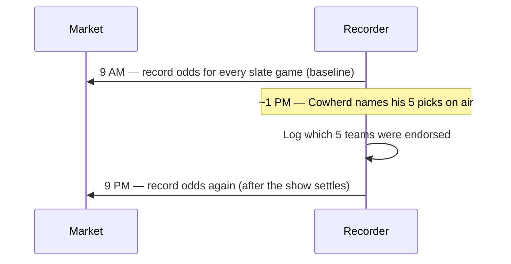

---
hide:
  - toc
---

# Data Collection

This page explains what gets written down, when, and how a betting price becomes a win probability. The data for this pilot is recorded by hand from a single sportsbook on one game weekend.

## The Timeline for One Weekend

All of the recording happens on Friday, around the broadcast of *The Herd*.

We pick one sportsbook and stay with it for the whole weekend, so that every number comes from the same source and the morning and evening prices are directly comparable.

## What Gets Recorded for Each Game

Each game is one row. The fields capture who is playing, whether Cowherd picked it, and the odds at both the morning and evening checkpoints.

| Field | What it holds | Example |
| :--- | :--- | :--- |
| Game identifier | A short label for the matchup and week | `KC_DEN_W06` |
| Away team | The visiting team | Kansas City |
| Home team | The hosting team | Denver |
| Picked by Cowherd | Whether this game is in the *Blazin' 5* (yes or no) | yes |
| Endorsed side | The team Cowherd backed, if any | Kansas City |
| Morning moneyline | The price for the tracked team at 9 AM | -150 |
| Evening moneyline | The price for the tracked team at 9 PM | -165 |

## Turning Odds Into a Win Probability

Betting odds come in two forms, and each converts to a win probability a little differently. A win probability is just the price restated as a percentage chance of winning.

- **A favorite** carries a negative number, like -150. The bigger the number, the stronger the favorite. The chance of winning is the size of the number divided by that same size plus 100. So -150 becomes 150 ÷ 250, or **60 percent**.
- **An underdog** carries a positive number, like +130. The chance of winning is 100 divided by the number plus 100. So +130 becomes 100 ÷ 230, or about **43 percent**.

We apply this to the morning price and the evening price for each tracked team, then take the difference. That difference, the shift in win probability over the day, is the single number the whole study rests on.

## Cleaning and Honest Caveats

A few things can muddy the measurement, and we flag them rather than hide them.

- **Friday injury news.** A late report that a key player is out can move a team's price for reasons that have nothing to do with Cowherd. These shifts are hard to separate from a tout effect in a sample this small.
- **The sportsbook's built-in margin.** Raw prices include a small house edge, so the two sides of a game add up to slightly more than 100 percent. For a first pass we leave the margin in, since it affects both groups the same way; a more careful version could remove it.
- **The thin sample.** One weekend is a handful of games. A single unusual game can tilt a group average, which is another reason this run is treated as a pilot.

Once the shifts are computed, the comparison and its meaning are covered on the [Results](./conclusions.md) page.
