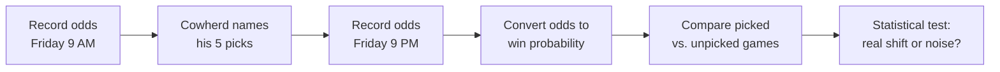

---
hide:
  - toc
---

  Pilot Statistical Experiment
  
Measuring the Blazin' 5 Effect

  
When a national TV personality names five NFL teams to bet, does the market's implied win probability actually move — or shrug it off as noise?

  
13Games this slate

  
5Picked games

  
8Control games

  
1 / 2Odds snapshots taken

# Overview

!!! info "Where the project stands"
    **Pre-experiment — baseline collected.** The design is set and the morning baseline odds (13 games) were recorded on October 16, 2026. The *Blazin' 5* picks and the evening reading are not in yet, so no comparison has been run. The [Baseline Readings](./baseline-readings.md) page shows the numbers collected so far.

This project tests a simple idea: when a famous sports-media personality tells millions of people which NFL teams to bet on, does the betting market actually move in response? We focus on one well-known weekly segment, Colin Cowherd's *Blazin' 5*, where he names five teams he favors against the point spread. The study measures whether the games he picks shift differently from the games he leaves alone, over the same few hours.

The result the project produces is a single comparison: the average change in each team's implied chance of winning for the picked games versus the unpicked games, along with a statistical test of whether that difference is real or just noise. Everything runs on a small set of odds snapshots recorded by hand on one game weekend, so this is best understood as a pilot: a first look to see whether the effect is worth a larger study.

## What Each Page Covers

Read these in order if you are new to the project.

| Page | What you will find |
| :--- | :--- |
| [Experiment Preparation](./pre-experiment-prep.md) | A one-page planning summary of every design item, before any data |
| [Key Question](./the-question.md) | Why the "tout effect" is worth testing and what we expect to see |
| [Planned Experiment](./the-experiment.md) | The groups, the measurement, the hypotheses, and the sample-size reasoning |
| [Data Collection](./data-collection.md) | What gets recorded, when, and how odds become a win probability |
| [Baseline Readings](./baseline-readings.md) | The morning odds collected so far, with implied win probabilities |
| [Results](./conclusions.md) | How to read the outcome and what it cannot claim |

## The Study at a Glance

