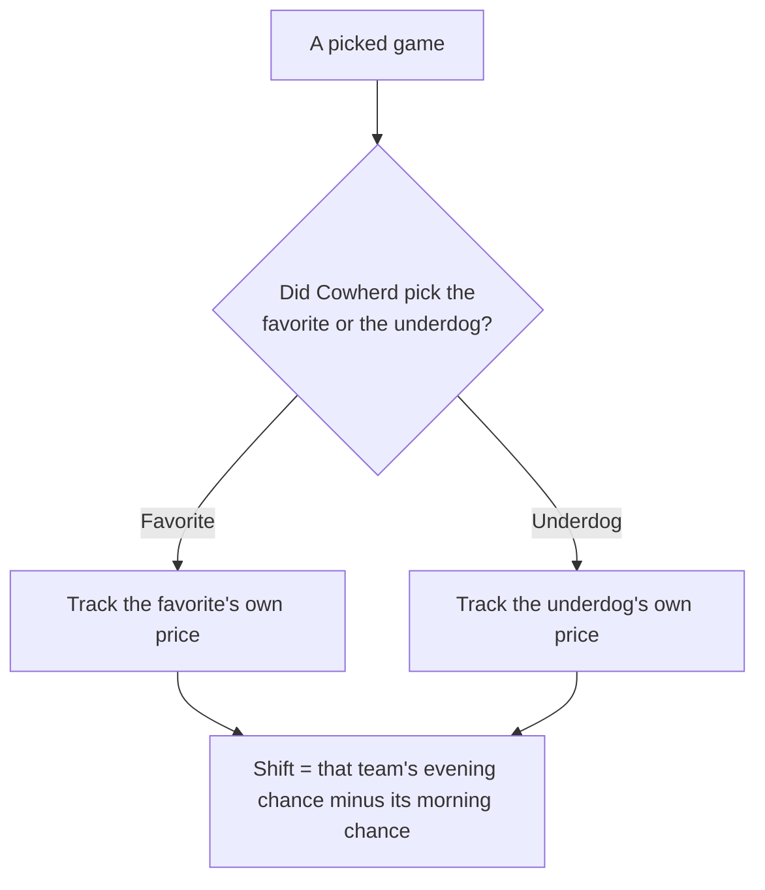
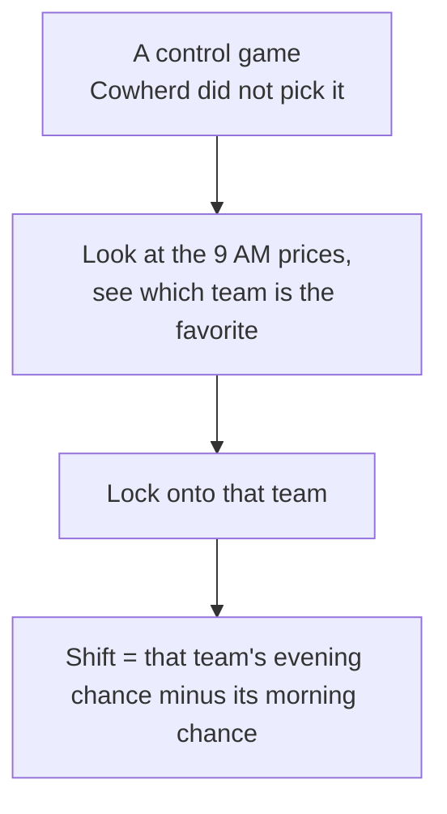
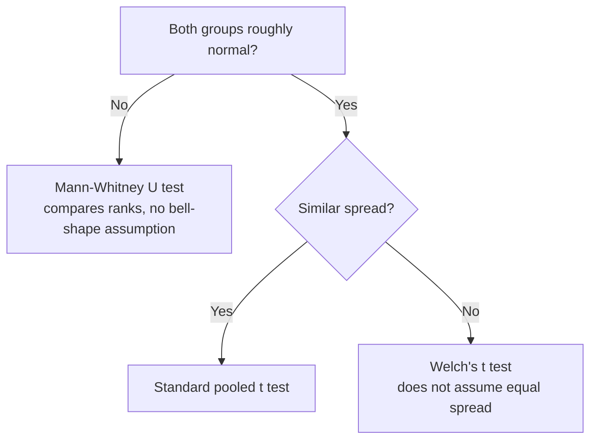

---
hide:
  - toc
---

# :material-calculator-variant: Methods and Statistical Choices

This page documents every calculation and statistical choice in the study so that the analysis can be followed and reproduced. It begins with the conversion the study rests on — turning a betting price into a chance of winning, and identifying which team that chance is measured for — then sets out each statistical decision and its rationale. The design, hypotheses, and data collection are on [Background and Design](./pre-experiment-prep.md).

The calculations live in `analysis/primary-comparison.py`, which reads three CSV files in `data/`: the 9 AM odds, the 9 PM odds, and the picks. Each odds file has one row per game with the game name, the spread, the favorite's moneyline, the underdog's moneyline, and a slate/source note. Every number quoted on this page was recomputed from that script against the collected data.

## Part 1: The Core Calculation

### What a Betting Price Is

A sportsbook lists each team with a price called a **moneyline**, written as a number such as `-148` or `+130`. The price encodes how likely the book considers the team to win. The study converts each price into a percentage — the team's **implied chance of winning** — and measures how that percentage changes over one day. There are two cases:

- **A favorite** carries a *negative* price, such as `-148`. The larger the number, the stronger the favorite.
- **An underdog** carries a *positive* price, such as `+130`. The larger the number, the longer the odds.

### Turning a Price Into a Chance of Winning

The two cases are a single formula. A moneyline is always quoted against a $100 bet, and the win chance is:

```
win chance = amount risked / (amount risked + amount won)
```

The favorite and underdog cases look different only because the sign indicates *which* of the two amounts is the $100:

- A **favorite** has a negative price, like `-148`, meaning "risk $148 to win $100." The amount risked is 148, so it goes on top.
- An **underdog** has a positive price, like `+130`, meaning "risk $100 to win $130." The amount risked is 100, so 100 goes on top.

In both cases, use the **absolute value** of the price — its size without the sign (the absolute value of `-148` is 148, and of `+130` is 130). The two formulas below are the same fraction; the only thing that moves is whether that absolute value or a flat `100` sits on top.

**Favorite (negative price):** the numerator is the price's absolute value.

```
win chance = |price| / (|price| + 100)
```

Worked example with `-148` (absolute value 148):

```
win chance = 148 / (148 + 100)
           = 148 / 248
           = 0.597   ->  59.7%
```

**Underdog (positive price):** the numerator is 100 instead.

```
win chance = 100 / (|price| + 100)
```

Worked example with `+130` (absolute value 130):

```
win chance = 100 / (130 + 100)
           = 100 / 230
           = 0.435   ->  43.5%
```

So the **only** difference between the two is the numerator: the favorite's own size for a favorite, a flat `100` for an underdog — because that is which side put up the $100. The denominator (`|price| + 100`) is identical. To turn the result into a percentage, multiply by 100 (0.597 → 59.7%).

What this percentage represents: it is the **sportsbook's market-implied chance of the team winning** — the chance built into the price the book offered. It reflects how the betting market priced the team, which is exactly what this study sets out to measure. The study tracks the **change** in that market-implied chance from morning to evening. (The prices here come from one sportsbook, DraftKings, as the example source, but the question is about sportsbook pricing and the tout effect in general, not about one book.)

### Which Team the Number Is Measured For

For each game there are two teams, so we have to be clear about whose chance of winning we track. The rule is simple:

- **For a picked game**, we track the team Cowherd picked — whether that team is the favorite or the underdog.
- **For every other game (the control group)**, we track the team that was favored in the morning reading. In plain terms: we look at the 9 AM prices, see which of the two teams is the favorite, lock onto that team, and then measure *that same team's* change in win probability from 9 AM to 9 PM. We pick the morning favorite before any of the day's movement happens, so the choice of which team to follow can't be influenced by the movement we're trying to measure. This gives one clearly-defined team per control game and serves as a neutral baseline for how a normal game's price drifts over the day when no one touted it.

The recorded data makes this direct: each game's row lists **both** the favorite's moneyline and the underdog's moneyline at both times, so the picked team is always scored from its own price — if Cowherd picked the underdog, we read the underdog's own line; if he picked the favorite, we read the favorite's.

A worked control example: in **Rams @ Raiders**, the Rams were favored in the morning at −192 (a 65.8% chance of winning). We follow the Rams: by evening their price was −180 (64.3%), so the shift we record for that game is 64.3 − 65.8 = **−1.5 points** — the Rams' own change, because they were the morning favorite.

**Picked game — follow the team Cowherd named:**



**Control game — no pick, so follow the morning favorite:**



For a picked game there is a choice of which team to follow, so the first diagram branches; for a control game there is no pick, so the rule is fixed — always the morning favorite — and there is nothing to branch on.

This slate had three underdog picks (**Falcons** `+2.5`, **Bengals** `+1.5`, **Chiefs** `+2.5`) and two favorite picks (**Browns** `−1.5`, **Lions** `−3`). Each was scored from its own recorded line, so every pick is measured the same clean way.

### The Outcome We Measure

For every game we compute one number: the **shift** — the tracked team's win chance in the evening minus its win chance in the morning, stated in percentage points.

```
shift = evening win chance - morning win chance
```

Worked example of a **picked game** — the **Bengals** (an underdog Cowherd picked): their own price was `-102` in the morning and `-108` in the evening.

```
morning:  102 / (102 + 100) = 102 / 202 = 50.50%
evening:  108 / (108 + 100) = 108 / 208 = 51.92%
shift  =  51.92% - 50.50%   = +1.43 percentage points
```

Worked example of a **control game** — the **Rams @ Raiders** game, which Cowherd did not pick, so the tracked team is the morning favorite (the Rams). The Rams' price was `-192` in the morning and `-180` in the evening.

```
morning:  192 / (192 + 100) = 192 / 292 = 65.75%
evening:  180 / (180 + 100) = 180 / 280 = 64.29%
shift  =  64.29% - 65.75%   = -1.47 percentage points
```

A positive shift means the team became more likely to win over the day; a negative shift means less likely. That single number per game is what every statistic below is built from.

### Why the Tests Use the Shift, Not the Raw Win Chances

Every statistical test in this study runs on the **shift** — the day's change — rather than on the raw morning or evening win chances. This is a deliberate design choice, and it is worth being explicit about, because it means the raw numbers are turned into a new measurement before any test runs.

The reason is that the raw win chances mostly reflect **how strong each team is**, not anything Cowherd did. The picked and control groups contain different teams with very different baseline strengths — on this slate the Texans sat at 83.9% and the Ravens at 54.1%. If a test compared the raw win chances of the picked teams against the control teams, it would mostly be measuring which strong or weak teams happened to land in each group, which has nothing to do with the research question.

The question is about **movement**: did the picked teams' prices move differently over the day. Movement is a change within a single game, so each game's numbers are collapsed into the one value that captures it — the shift. Subtracting each team's morning chance from its own evening chance cancels out that team's baseline strength, leaving only how much it moved. The comparison then isolates exactly what the study is about.

This is a standard approach, not a shortcut: measuring a "before" and an "after" for each subject and testing the **difference** is a textbook pre/post design. The shift is this study's outcome variable, built once from the raw prices, and the hypotheses and tests are all defined on it.

## Part 2: Every Statistical Choice

The comparison is the **average shift of the five picked games minus the average shift of the eight control games** (the groups are defined on [Background and Design](./pre-experiment-prep.md)). A positive difference means the picked sides gained more chance of winning over the day than the rest of the slate. Each choice below names what was decided, the exact setting used, and why.

### Choice 1: A Two-Sided Test

We test whether the two groups differ **in either direction**, rather than only checking whether the picked games went up.

**Why:** two outcomes are both plausible and both interesting. A popular pick could draw casual money that pushes its price up, or it could draw sharp bettors who bet against the crowd and pull it down. Committing in advance to only one direction would miss the other, so the test stays open to both.

### Choice 2: The p-value

The **p-value** answers one question: if Cowherd's picks changed nothing, how often would a gap at least this big still show up by luck?

On this slate the gap is 0.86 percentage points and the p-value is **0.175**. That means a gap this large would show up about 18 times in 100 even if the picks did nothing.

Before looking at the data, the study set a bar of **0.05** (5 times in 100). A p-value has to come in under that bar before the gap counts as more than luck. **0.175 is above 0.05**, so this slate does not clear the bar.

The p-value does not say whether the gap is small or large. It only says how ordinary the gap would be if nothing real were going on. The same 0.05 bar is reused for the Shapiro-Wilk and Levene checks in Choice 4. Those checks only choose the test. They are not separate findings.

### Choice 3: Cohen's d

**Cohen's d** answers a different question: how big is the gap, compared with how much games normally bounce around?

The two groups differ by 0.86 percentage points. The typical game-to-game bounce is about 1 percentage point. Divide the gap by that bounce:

```
Cohen's d = 0.86 / 1.03 ≈ 0.83
```

A common yardstick is 0.2 small, 0.5 medium, and 0.8 large. **0.83 is large.** The picked games and the other games are far apart relative to the scatter.

Cohen's d does not say the gap can be trusted. It only says the gap is big next to the usual bounce. With five picked games and eight other games, 0.83 is a rough description of this one slate, not a precise size for every future week.

### How the p-value and Cohen's d fit together

Read them as a pair. They answer different questions about the same 0.86-point gap.

- **Cohen's d (0.83)** says the gap looks large next to the usual bounce.
- **The p-value (0.175)** says that, with only 13 games, a gap that large still happens fairly often by luck.
- **The 95% interval (−0.44 to +2.16)** says the same thing as the p-value, in percentage points. The range still includes zero, so "no difference" is still allowed.

A large d with a p-value above 0.05 is what a real tout effect looks like when the sample is too small to pin it down. It is also what one lucky week looks like. This slate cannot tell those two stories apart, so both numbers are reported and neither one is used alone.

### Choice 4: Checking the Conditions Before Choosing the Test

Before comparing the averages, two conditions are checked, because they decide which comparison is valid. **These checks only pick the test; they are not findings on their own.**

| Check | What it asks | Setting | Result on this slate |
| :--- | :--- | :--- | :--- |
| Shapiro-Wilk | Are each group's shifts close to a normal, bell-shaped spread? | compared against alpha 0.05 | picked p = 0.369, control p = 0.638 — both pass |
| Levene (centered on the median) | Are the two groups about equally spread out? | median-centered, the sturdy form | p = 0.840 — spreads look similar |

Levene is centered on the **median** rather than the mean because the median form is less thrown off by a single unusually large move, which matters for small, lumpy data.

A caution stated plainly: with only five picked-game shifts and eight control-game shifts, these checks have very little ability to detect a problem, so passing them is weak evidence rather than proof that the data is well-behaved. A more cautious analysis would also run the **Mann-Whitney U test** (described in Choice 5, which compares the two groups by ranking all the shift values instead of averaging them, and so makes no bell-shape assumption) alongside the t test, and confirm the two agree — a robustness check against the normality assumption.

### Choice 5: Which Comparison Test Runs

The result of Choice 4 selects the test automatically:



On this slate both groups passed the normality check and had similar spread, so the study used the **standard pooled t test** (a test that compares the two groups' average shifts). The Mann-Whitney U fallback exists so that data which is clearly not bell-shaped is not forced through a test that assumes it is: instead of averaging, Mann-Whitney sorts all 13 shift values from lowest to highest, assigns each a rank, and compares whether the picked games' ranks sit systematically higher or lower than the control games' ranks. It was not needed here because both groups passed the normality check.

### Choice 6: The Confidence Interval

The study reports a **95% confidence interval** for the difference between the two group averages: on this slate, **−0.44 to +2.16 percentage points**.

**Why:** the single difference (+0.86 points) is one estimate; the interval shows the range of values consistent with the data. This interval still includes zero — most of it sits above zero, but because it crosses zero the difference is not statistically distinguishable from no difference.

### Choice 7: Sample Size Is a Design Target, Not a Claim About This Weekend

The script also reports how many games the design *would* need to reliably detect a difference: about **128 games** for a moderate effect (d = 0.5) or **52** for a large one (d = 0.8), using the 0.05 cutoff and an 80% chance of detection.

**Why, and the important caution:** these are targets worked out in advance for the full design. They are **not** a measure of how much evidence this 13-game weekend carries. This slate is far below those numbers, so it is deliberately an underpowered pilot — it can show the measurement works and hint at a direction, but it cannot settle the question.

## The Calculation, Step by Step

This section works the comparison from the raw per-game shifts to the final numbers, so each figure can be checked by hand. All shifts are in percentage points.

**Step 1 — the per-game shifts in each group.** Each value is one game's shift, computed as in the worked examples above.

```
picked (5 games):   0.00,  1.43,  0.93, -0.81,  1.32
control (8 games):  0.00, -1.80,  0.72, -1.05,  1.33,  0.00,  0.00, -1.47
```

**Step 2 — the group averages (means).** Add each group's shifts and divide by the number of games in that group.

```
picked mean  = (0.00 + 1.43 + 0.93 - 0.81 + 1.32) / 5 = 2.87 / 5 =  +0.57
control mean = (0.00 - 1.80 + 0.72 - 1.05 + 1.33 + 0.00 + 0.00 - 1.47) / 8
             = -2.27 / 8 = -0.28
```

**Step 3 — the difference between the groups.** Picked average minus control average.

```
difference = +0.57 - (-0.28) = +0.86 percentage points
```

**Step 4 — the spread within each group (standard deviation).** The standard deviation measures how scattered each group's shifts are around its own average.

```
picked standard deviation  ≈ 0.96
control standard deviation ≈ 1.08
```

**Step 5 — Cohen's d (how big the gap is).** Divide the 0.86-point gap by the typical bounce, about 1 point. See Choice 3.

```
pooled standard deviation ≈ 1.03
Cohen's d = 0.86 / 1.03 ≈ 0.83   (large on the 0.2 / 0.5 / 0.8 yardstick)
```

**Step 6 — the p-value (how ordinary the gap would be if nothing were going on).** The t test turns the same gap into a p-value of **0.175**. That is above 0.05, so the gap does not clear the luck bar. See Choice 2.

**Step 7 — the 95% confidence interval.** The range of true differences consistent with the data is **−0.44 to +2.16 percentage points**. It leans positive but crosses zero, so a true difference of zero is still consistent with the result.

## What the Numbers Came Out To

Putting the choices together on this one slate:

| Quantity | Value |
| :--- | :--- |
| Number of games | 5 picked, 8 control (13 total) |
| Average shift, picked | +0.57 percentage points |
| Average shift, control | −0.28 percentage points |
| Difference (picked − control) | **+0.86 percentage points** |
| 95% confidence interval | −0.44 to +2.16 points |
| Test used | standard pooled t test |
| p-value | **0.175** |
| Cohen's d | 0.83 |
| Difference beyond chance? | **No** |

The headline: on this slate the picked games rose a little while the rest of the slate drifted down slightly, a gap of about **0.86 percentage points** in the picked games' favor. That gap is a large effect size (d = 0.83), but with only 13 games the test does not reach significance (p = 0.175) — the difference points in the direction of a tout effect without being strong enough to rule out chance. How to read that result, and what it cannot claim, is on the [Results](./conclusions.md) page.
