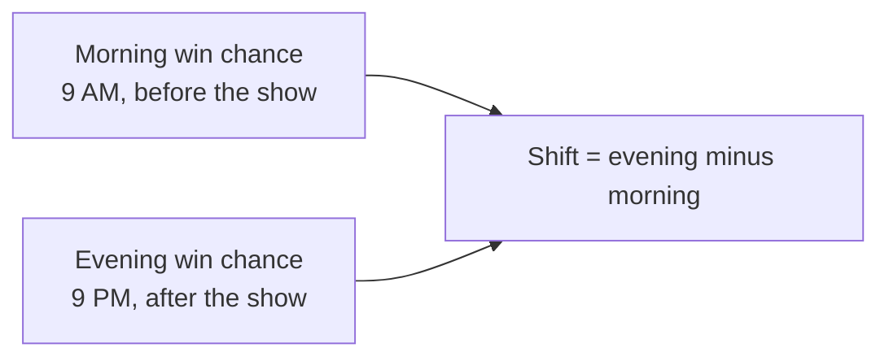

---
hide:
  - toc
---

# Planned Experiment

This page describes how the question becomes a measurement: which games go in which group, what we measure for each, and how we decide whether the picked games behaved differently.

## The Two Groups

Every game on the weekend slate falls into one of two groups based on a single fact: did Cowherd name it or not.

| Group | What it contains | Rough size for one weekend |
| :--- | :--- | :--- |
| Picked games | The five games Cowherd endorses in the *Blazin' 5* | 5 |
| Unpicked games | The rest of the Sunday and Monday slate | 10 to 11 |

The thing that separates the groups is the pick itself. For a picked game we track the price of the exact team Cowherd endorsed. For an unpicked game we track the team the market already favored before the show, so that both groups are measured in a consistent direction.

## What We Measure

For every team we care about, we record its implied chance of winning twice on the same day: once in the morning before the show airs, and once in the evening after the betting has had time to settle. The measurement for each team is the difference between those two numbers.

A positive shift means the team's price moved in its favor over the day. A negative shift means it moved against. We then compare the average shift of the picked group against the average shift of the unpicked group.

## The Two Possibilities We Are Testing

Stated plainly, the experiment weighs one claim against the other.

- **No effect:** the picked games shift, on average, by the same amount as the unpicked games. Cowherd's segment leaves no mark on the market.
- **An effect:** the picked games shift, on average, by a different amount than the unpicked games. The direction could go either way. The crowd could inflate the picked teams, or sharp bettors could push back against the popular pick.

We test for a difference in either direction rather than assuming the picks must help the endorsed team, because both outcomes are plausible and both would be interesting.

## Why a Win Probability Instead of the Point Spread

The project measures the shift in implied win probability rather than the movement of the point spread, for two reasons.

- **Point spreads get stuck on common numbers.** NFL margins cluster on 3, 7, and 10 points, so sportsbooks often hold the spread steady and adjust the price around it instead. A spread that does not move can hide real market activity.
- **A win probability is a smooth percentage.** It can take any value and shift by small amounts, which makes it a cleaner thing to average and test than a spread that jumps in half-point steps.

How the raw odds become a win probability is covered on the [Data Collection](./data-collection.md) page.

## How Much Data Would Settle the Question

A standard sample-size calculation tells us how many games we would need to reliably detect an effect of a given size, assuming a 5 percent chance of a false alarm and an 80 percent chance of catching a real effect. For a moderate effect, that works out to somewhere in the range of **64 to 128 games**, which is roughly a full NFL season of weekends rather than one.

One weekend of about 15 games is well short of that. We state this up front: this pilot is **underpowered on purpose**. Its job is to prove the measurement works and to hint at a direction, not to deliver a final verdict. For what the results can and cannot claim, see the [Results](./conclusions.md) page.
